# TP 1 — Installation de VirtualBox et création d'une VM Ubuntu

**Introduction au Cloud · L3 SI RIST & BDGL**

| | |
|---|---|
| **Trinôme** | KONATE ABDOULAYE · SAVANE LACINA · DOSSO SARAH |
| **Dépôt Git** | Administrateur01/PROJECT-TRINOME_CLOUD |
| **Séance** | 1 — Découverte de la virtualisation |
| **Hôte** | Windows 10 (version 10.0.19045), Intel Core i5-7300U @ 2,60 GHz (2 cœurs / 4 threads), 8071 Mo de RAM (≈ 8 Go) |
| **VM** | `ubuntu-srv` : Ubuntu Server 26.04.1 LTS, 2 vCPU, 2 Go de RAM, disque VDI 25 Go |

> **Captures d'écran** : elles sont placées dans le dossier `img/` du dépôt et référencées dans chaque partie.

---

## Partie 1 — Préparer l'hôte et installer VirtualBox

### Commandes lancées

Vérification de la virtualisation matérielle : Gestionnaire des tâches → Performance → Processeur, ligne « Virtualisation ».

Vérification de l'hyperviseur Windows (PowerShell administrateur) :

```powershell
bcdedit /enum | findstr hypervisorlaunchtype
systeminfo | findstr /C:"Hyper-V"
```

Vérification de l'installation de VirtualBox :

```powershell
$env:Path += ";C:\Program Files\Oracle\VirtualBox"
VBoxManage --version
VBoxManage list hostinfo
```

### Résultats

**Étape 1 — Virtualisation matérielle (VT-x)** : **Activée** dans le Gestionnaire des tâches.

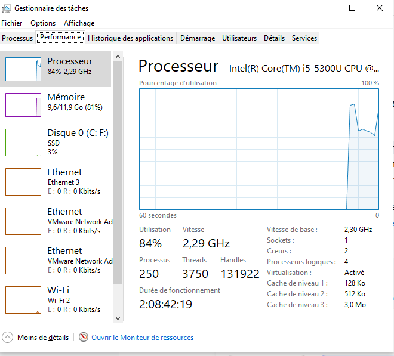

**Étape 2 — Hyperviseur de Windows : un problème détecté, puis corrigé**

Avant correction, les deux commandes donnent :

- `bcdedit /enum | findstr hypervisorlaunchtype` → `hypervisorlaunchtype  Auto` : l'hyperviseur de Windows est **lancé automatiquement au démarrage**.
- `systeminfo | findstr /C:"Hyper-V"` → *« Un hyperviseur a été détecté. Les fonctionnalités nécessaires à Hyper-V ne seront pas affichées. »*

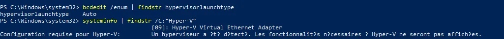

**Interprétation.** Hyper-V (ou un composant qui s'appuie dessus, comme WSL 2 ou l'isolation du noyau) est actif sur notre PC et occupe la virtualisation matérielle. VirtualBox ne peut pas bien fonctionner en même temps : soit il refuse de démarrer, soit il passe dans un mode de simulation beaucoup plus lent (icône de tortue verte). C'est exactement le cas décrit dans le tableau de dépannage de la fiche.

**Correction** (PowerShell administrateur), puis redémarrage de la machine :

```powershell
bcdedit /set hypervisorlaunchtype off
```

La commande répond « L'opération a réussi. ».

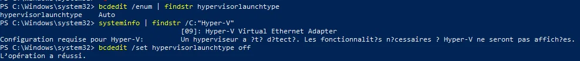

**Vérification après redémarrage** : la ligne *« Un hyperviseur a été détecté… »* a **totalement disparu** de la sortie de `systeminfo`, qui indique maintenant *« Extensions de mode du moniteur d'ordinateur virtuel : Oui »*. La virtualisation matérielle est donc libre pour VirtualBox.

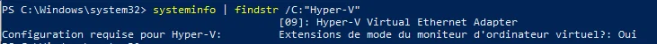

> **Conséquence** : tant que cette option est sur `off`, WSL 2 et Docker Desktop ne fonctionnent plus. Pour les réactiver plus tard : `bcdedit /set hypervisorlaunchtype auto`, puis redémarrer.

**Étape 4 — Vérification de VirtualBox** :

- `VBoxManage --version` → **7.2.22r175245**.
- `VBoxManage list hostinfo` → 4 processeurs logiques (**2 cœurs**), **Intel Core i5-7300U @ 2,60 GHz**, **8071 Mo de RAM**, Windows 10 (10.0.19045.6466). Les lignes `Processor supports HW virtualization: yes`, `long mode: yes` et `nested paging: yes` confirment la prise en charge de la virtualisation matérielle et des systèmes 64 bits.

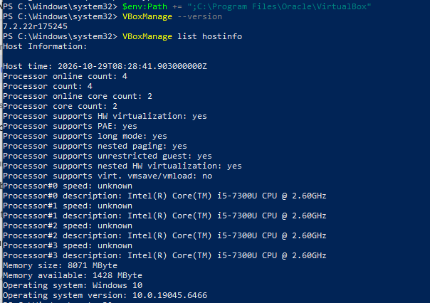

### Réponses aux questions

**1. Qu'est-ce qu'un hyperviseur de type 1 et de type 2 ? Dans quelle catégorie se range VirtualBox ? Citez un hyperviseur de type 1 utilisé par un fournisseur cloud.**

Un hyperviseur est un logiciel qui permet de faire tourner plusieurs machines virtuelles sur une même machine physique en partageant ses ressources (CPU, RAM, disque, réseau).

- **Type 1 (bare metal)** : l'hyperviseur s'exécute directement sur le matériel, sans système d'exploitation intermédiaire. Il est performant et sert dans les datacenters.
- **Type 2 (hébergé)** : l'hyperviseur est une application installée sur un système d'exploitation existant (ici Windows 10). Il est plus simple à installer, idéal pour apprendre, mais moins performant à cause de la couche supplémentaire.

**VirtualBox est un hyperviseur de type 2** : c'est une application qui s'installe sur Windows.

Exemples de type 1 chez les fournisseurs cloud : **Xen / Nitro** (AWS), **Hyper-V** (Azure), **KVM** (Google Cloud).

**2. Pourquoi la virtualisation matérielle (VT-x / AMD-V) est-elle indispensable pour faire tourner une VM 64 bits ?**

VT-x (Intel) et AMD-V (AMD) sont des extensions du processeur qui permettent d'exécuter directement le code de la VM sur le processeur physique, de façon isolée, sans émulation logicielle lente. Pour les systèmes invités 64 bits, VirtualBox s'appuie sur ces extensions : quand elles sont désactivées, il n'est plus possible de créer une VM 64 bits et seuls des systèmes 32 bits (par exemple « Ubuntu (32-bit) ») sont proposés. Il faut alors activer VT-x / AMD-V (SVM) dans le BIOS/UEFI.

**3. Quelle version de VirtualBox avez-vous installée ? Que renvoie `VBoxManage list hostinfo` sur le nombre de cœurs et la RAM de l'hôte ?**

Nous avons installé **VirtualBox 7.2.22** (build r175245). `VBoxManage list hostinfo` indique un processeur **Intel Core i5-7300U avec 2 cœurs physiques (4 processeurs logiques)** et **8071 Mo de RAM (environ 8 Go)**, avec la virtualisation matérielle disponible (`Processor supports HW virtualization: yes`).

---

## Partie 2 — Télécharger et vérifier l'image ISO Ubuntu

### Commandes lancées

```powershell
cd $HOME\Downloads
Get-FileHash .\ubuntu-26.04.1-live-server-amd64.iso -Algorithm SHA256
Select-String -Path .\SHA256SUMS -Pattern "live-server-amd64"
```

### Résultats

- Image utilisée : `ubuntu-26.04.1-live-server-amd64.iso` (Ubuntu Server LTS, amd64).
- Empreinte calculée par `Get-FileHash` : commence par `CC8A95CD…` et se termine par `…1D927`.
- Ligne correspondante dans `SHA256SUMS` : commence par `CC8A95CD…` et se termine par `…1D927`.

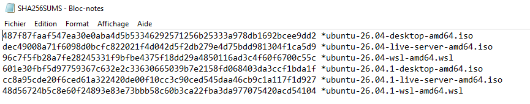
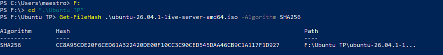

### Réponses aux questions

**1. Les deux empreintes sont-elles identiques ? Pourquoi faut-il vérifier l'empreinte d'une image avant de l'installer ?**

**Oui, les deux empreintes sont identiques** (elles commencent par `CC8A95CD` et se terminent par `1D927` des deux côtés). Le fichier est donc intact et conforme à celui publié par Ubuntu.

Vérifier l'empreinte garantit :
- l'**intégrité** : le téléchargement n'a pas été corrompu (une seule erreur de bit change complètement l'empreinte) ;
- l'**authenticité** : l'image n'a pas été modifiée ou piégée par un tiers (miroir compromis, attaque sur le trajet). Installer un serveur à partir d'une image falsifiée compromettrait toute la machine dès le départ.

**2. Quelle différence entre Ubuntu Desktop et Ubuntu Server ? Pourquoi choisit-on Server pour un serveur cloud ?**

| | Desktop | Server |
|---|---|---|
| Interface | Graphique (GNOME) | Ligne de commande |
| Usage | Poste de travail | Serveur, cloud |
| Ressources | Gourmand | Minimal |
| Administration | Sur place | À distance (SSH) |

On choisit Server pour un serveur cloud parce qu'il consomme peu de ressources (pas d'interface graphique), expose moins de logiciels donc **moins de surface d'attaque**, et s'administre à distance par SSH, ce qui correspond à l'usage d'une instance cloud.

*Remarque (difficulté rencontrée) : nous avions d'abord téléchargé par erreur l'ISO Ubuntu Desktop (environ 6 Go). Nous l'avons remplacée par l'ISO `live-server` et vérifié son empreinte avant toute installation.*

**3. Que signifie LTS ? Combien d'années de mises à jour de sécurité standard une version LTS reçoit-elle ?**

**LTS = Long Term Support** (support à long terme). Une version LTS reçoit **5 ans** de mises à jour de sécurité standard (jusqu'à 10 ans avec Ubuntu Pro). C'est la version recommandée pour la production, car elle est stable et suivie longtemps.

---

## Partie 3 — Créer et configurer la machine virtuelle

### Paramètres de la VM

| Paramètre | Valeur |
|---|---|
| Nom | `ubuntu-srv` |
| Type / version | Linux / Ubuntu (64-bit) |
| Image ISO | `ubuntu-26.04.1-live-server-amd64.iso` |
| Mémoire vive | 2048 Mo |
| Processeurs | 2 |
| Disque dur | VDI, 25 Go, alloué dynamiquement |
| Contrôleur de stockage | SATA (IntelAhci) |
| Carte réseau 1 | NAT (carte 82540EM) |
| Redirection de port | `ssh`, TCP, 127.0.0.1:2222 → port invité 22 |

### Commandes lancées (variante en ligne de commande)

Nous avons créé la VM entièrement avec `VBoxManage`, comme une instance cloud se crée par l'API :

```powershell
$vm = "ubuntu-srv"
$dir = "$HOME\VirtualBox VMs\$vm"
$iso = "$HOME\Downloads\ubuntu-26.04.1-live-server-amd64.iso"

VBoxManage createvm --name $vm --ostype Ubuntu_64 --register
VBoxManage modifyvm $vm --cpus 2 --memory 2048 --vram 16 --nic1 nat --natpf1 "ssh,tcp,127.0.0.1,2222,,22"
VBoxManage createmedium disk --filename "$dir\$vm.vdi" --size 25600 --format VDI
VBoxManage storagectl $vm --name SATA --add sata --controller IntelAhci
VBoxManage storageattach $vm --storagectl SATA --port 0 --device 0 --type hdd --medium "$dir\$vm.vdi"
VBoxManage storageattach $vm --storagectl SATA --port 1 --device 0 --type dvddrive --medium $iso
VBoxManage showvminfo $vm
```

### Résultats

`VBoxManage showvminfo ubuntu-srv` confirme : Ubuntu 64 bits, 2048 Mo de RAM, 2 processeurs, disque VDI de 25 Go sur contrôleur SATA, ISO attachée en lecteur DVD, carte réseau en NAT avec la règle de redirection `ssh`.

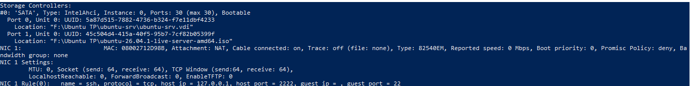

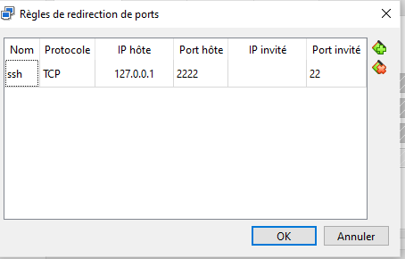

### Réponses aux questions

**1. Quelle différence entre un disque alloué dynamiquement et un disque de taille fixe ? Quelle place occupe le fichier `.vdi` juste après sa création ?**

- **Disque de taille fixe** : le fichier occupe immédiatement toute la taille déclarée (25 Go) sur le disque de l'hôte. Il est un peu plus rapide, mais consomme tout de suite la place.
- **Disque alloué dynamiquement** : le fichier ne grossit qu'au fur et à mesure que la VM écrit des données, jusqu'à la limite de 25 Go. Il économise de la place, mais peut ralentir légèrement lors de la croissance.

Juste après sa création, le fichier `.vdi` dynamique est **très petit** : il ne contient que ses métadonnées et reste très loin des 25 Go déclarés. Il grossira ensuite au fil des écritures de la VM.

**2. Pourquoi désactive-t-on l'installation sans surveillance pour ce TP ?**

L'installation sans surveillance (unattended) remplit automatiquement les réponses de l'installateur. Pour ce TP, nous voulons **faire nous-mêmes chaque choix** (langue, clavier, réseau, stockage LVM, profil, installation d'OpenSSH) afin de comprendre ce qu'un fournisseur cloud automatise, et de maîtriser la configuration finale de la VM (par exemple OpenSSH, indispensable pour la suite).

**3. En mode NAT, pourquoi l'hôte ne peut-il pas joindre directement la VM ? À quoi sert la redirection 2222 → 22 ?**

En mode NAT, la VM est cachée derrière un **routeur virtuel** de VirtualBox : elle reçoit une adresse privée (10.0.2.15) qui n'existe que dans ce réseau virtuel. Elle peut sortir vers Internet (la connexion sortante est traduite par le NAT), mais **aucune connexion entrante ne peut l'atteindre directement**, y compris depuis l'hôte.

La **redirection de port** crée une porte d'entrée : tout ce que l'hôte reçoit sur `127.0.0.1:2222` est transmis au port 22 (SSH) de la VM. C'est le même principe qu'une instance cloud placée dans un sous-réseau privé avec une règle d'accès SSH.

---

## Partie 4 — Installer Ubuntu Server

### Choix faits dans l'installateur

| Écran | Choix |
|---|---|
| Langue | Français |
| Mise à jour de l'installateur | Continuer sans mettre à jour |
| Clavier | French (AZERTY) |
| Type d'installation | Ubuntu Server (pas la version minimisée) |
| Réseau | `enp0s3` en DHCPv4 : adresse `10.0.2.15` |
| Proxy / miroir | Par défaut |
| Stockage | Tout le disque, avec LVM (choix par défaut) |
| Profil | Serveur `ubuntu-srv`, utilisateur `etudiant` |
| Ubuntu Pro | Passé |
| SSH | « Installer le serveur OpenSSH » coché |
| Snaps | Aucun |

À la fin, redémarrage (touche Entrée au message « Please remove the installation medium »), puis connexion sur la console avec l'utilisateur `etudiant`.

### Réponses aux questions

**1. Combien de temps a duré l'installation ? Comparez avec la création d'une instance cloud à partir d'une image prête.**

L'installation a duré **environ 15 minutes** de bout en bout. Une instance cloud lancée à partir d'une image déjà installée (AMI, image Azure) démarre en **quelques dizaines de secondes à environ 2 minutes** : il n'y a ni partitionnement, ni copie de paquets à faire, et chaque instance est identique. C'est précisément ce que le cloud IaaS automatise.

**2. Quelle adresse IP l'installateur a-t-il obtenue sur `enp0s3` ? Qui l'a attribuée ?**

L'installateur a obtenu l'adresse **`10.0.2.15`** (en `/24`). Elle a été attribuée **dynamiquement par le serveur DHCP intégré à VirtualBox** (mode NAT).

**3. Pourquoi installe-t-on le serveur OpenSSH dès l'installation ? Que se passerait-il sur un serveur cloud sans SSH ?**

Un serveur n'a pas d'interface graphique et s'administre à distance : sans OpenSSH, on ne pourrait pas s'y connecter depuis l'hôte (erreur `Connection refused` sur le port 2222) et il faudrait passer par la console de la VM. Sur un serveur cloud **sans SSH** (et sans autre moyen d'accès), la machine serait pratiquement **inadministrable** : impossible de la configurer ou de la dépanner à distance, au point qu'il faudrait la recréer.

---

## Partie 5 — Premiers pas, réseau et accès SSH

### Commandes lancées dans la VM

Identification du système et des ressources :

```bash
lsb_release -a
uname -r
hostnamectl
nproc
free -h
df -h /
lsblk
```

Réseau et accès Internet :

```bash
ip -4 addr show
ip route
resolvectl status | grep "DNS Servers"
ping -c 3 ubuntu.com
sudo apt update && sudo apt upgrade -y
```

Serveur SSH :

```bash
systemctl status ssh --no-pager
sudo ss -tlnp | grep :22
```

### Résultats

**Système et ressources** (`hostnamectl`, `uname -r`, `nproc`, `free -h`, `df -h /`, `lsblk`) :

| Élément | Résultat |
|---|---|
| Système | Ubuntu **26.04.1 LTS** |
| Noyau | Linux **7.0.0-38-generic**, architecture x86-64 |
| Virtualisation | `oracle` (matériel : VirtualBox) |
| Nom d'hôte | `ubuntu-srv` |
| Processeurs (`nproc`) | **2** |
| Mémoire (`free -h`) | 3,3 Gi au total, 462 Mi utilisés, 2,9 Gi disponibles ; swap 2,0 Gi |
| Disque (`df -h /`) | système de fichiers racine de **12 Go** (5,4 Go utilisés, 51 %) sur `/dev/mapper/ubuntu--vg-ubuntu--lv` |
| Disque (`lsblk`) | disque `sda` de **25 Go** : `sda1` (1 Mo), `sda2` `/boot` (2 Go), `sda3` (23 Go) contenant le volume logique LVM `/` de **11,5 Go** |

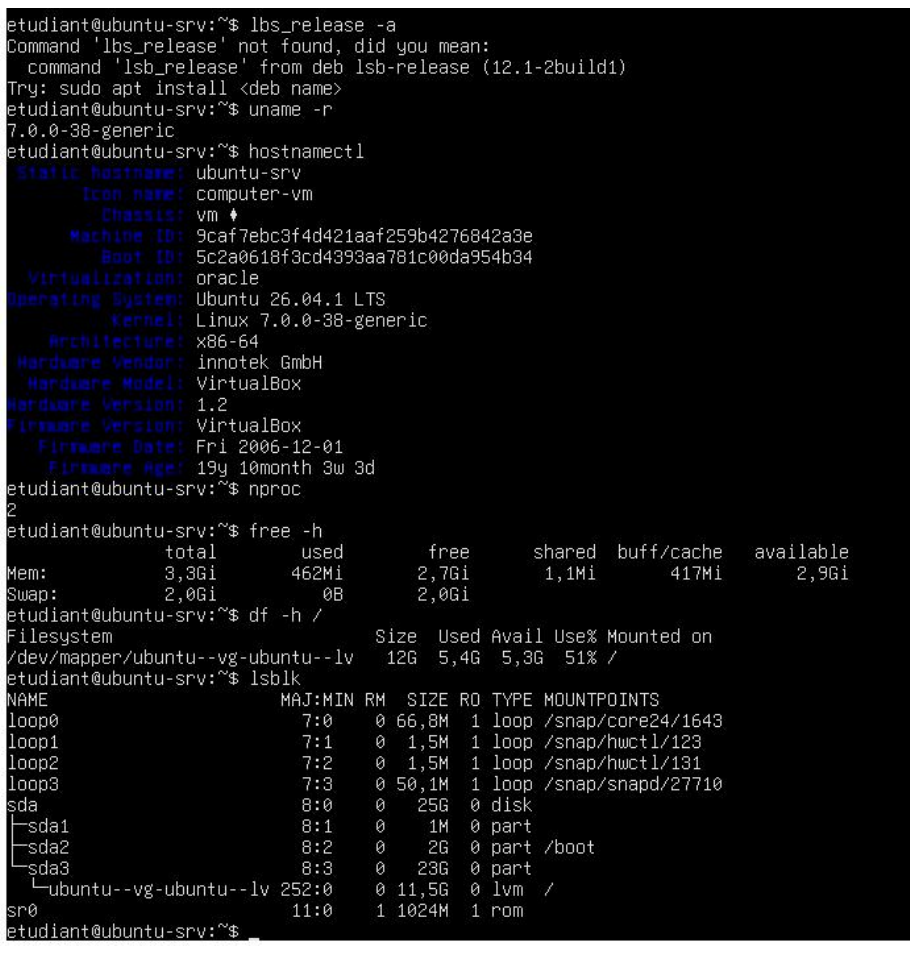

> **Observation.** Le disque fait bien 25 Go, mais le volume logique racine n'occupe que **11,5 Go** : par défaut, l'installateur Ubuntu avec LVM n'alloue pas tout l'espace disponible. Il reste de la place pour agrandir `/` plus tard (`lvextend`), ce qui est un avantage de LVM. La version du système est lue avec `hostnamectl` (Ubuntu 26.04.1 LTS).

**Réseau** (`ip -4 addr show`, `ip route`) :

- Interface `enp0s3` à l'état **UP**, adresse **`10.0.2.15/24`**, attribuée dynamiquement (`dynamic`, bail DHCP d'environ 85 670 s, soit près de 24 h).
- Route par défaut : **`default via 10.0.2.2`**, réseau local `10.0.2.0/24`, et deux routes DHCP vers `10.0.2.2` (passerelle) et **`10.0.2.3`**.
- Serveur DNS : **`10.0.2.3`**, le serveur DNS du NAT de VirtualBox, déjà visible dans la table de routage (route DHCP).

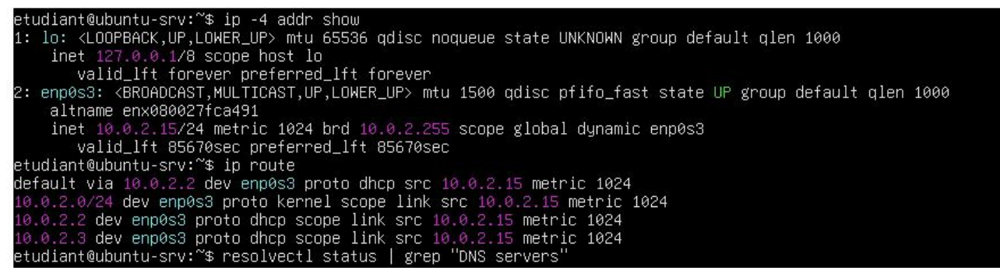

**Accès à Internet** : `ping -c 3 ubuntu.com` → **3 paquets émis, 3 reçus, 0 % de perte**, temps moyen d'environ **179 ms**. Le nom `ubuntu.com` a été résolu en `185.125.190.20` : la **résolution DNS** et la **sortie vers Internet** (NAT) fonctionnent.

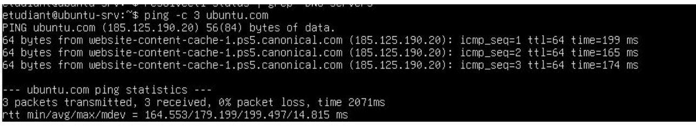

`sudo apt update && sudo apt upgrade -y` : les dépôts `ci.archive.ubuntu.com` et `security.ubuntu.com` (version `resolute`) sont interrogés, ce qui confirme que la VM accède aux dépôts Ubuntu.

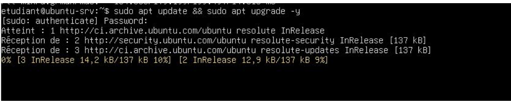

**Serveur SSH** (`systemctl status ssh --no-pager`) : le service apparaît `inactive (dead)` et `TriggeredBy: ssh.socket`. Sur cette version d'Ubuntu, SSH est lancé **à la demande** : l'unité `ssh.socket` écoute sur le port 22 et démarre `ssh.service` à la première connexion. Le service peut donc sembler arrêté tant que personne ne s'est connecté, ce qui n'empêche pas l'accès (la connexion ci-dessous fonctionne).

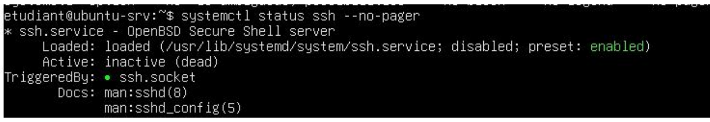

### Commandes lancées depuis PowerShell (hôte)

```powershell
ssh -p 2222 etudiant@127.0.0.1
# accepter l'empreinte du serveur (yes), saisir le mot de passe, puis : exit

"Bonjour depuis l'hôte" | Out-File -Encoding utf8 bonjour.txt
scp -P 2222 .\bonjour.txt etudiant@127.0.0.1:~
ssh -p 2222 etudiant@127.0.0.1 "cat ~/bonjour.txt"
```

### Résultats

**Connexion SSH** : la connexion à `127.0.0.1:2222` fonctionne avec le mot de passe de `etudiant`. Le message d'accueil confirme *Welcome to Ubuntu 26.04.1 LTS (GNU/Linux 7.0.0-38-generic x86_64)* et indique notamment l'adresse `10.0.2.15` sur `enp0s3`, 125 processus et **25 mises à jour disponibles** (avant notre `apt upgrade`).

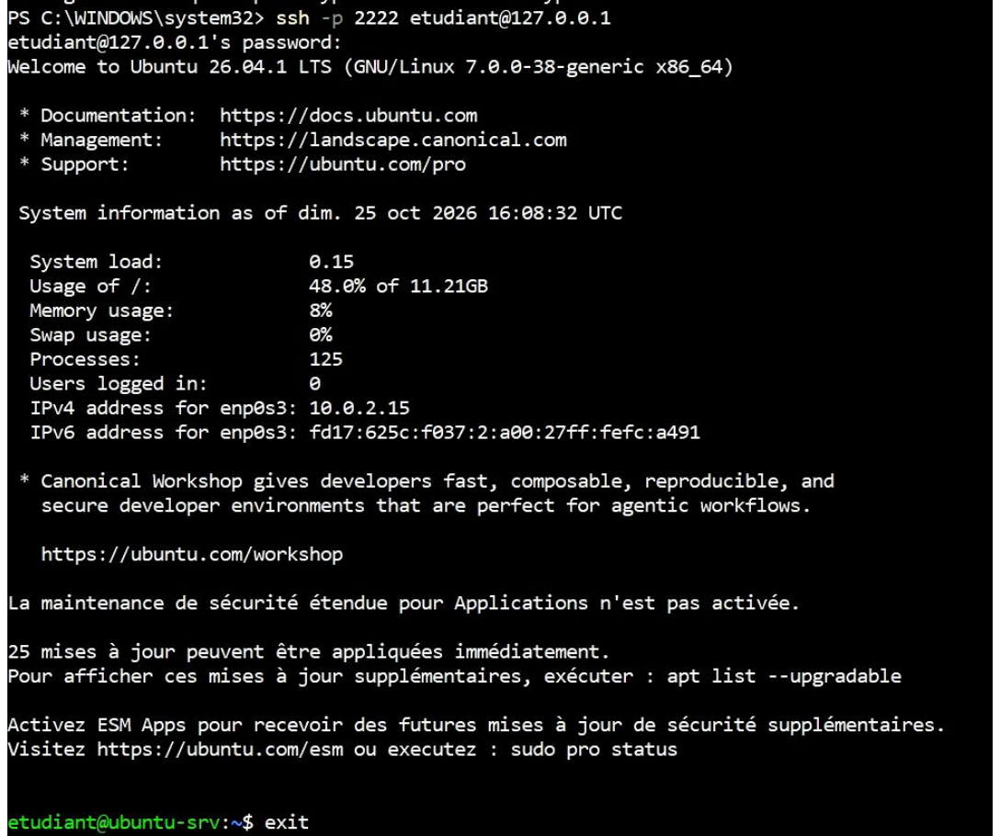

**Copie de fichier** : `scp` transfère `bonjour.txt` (27 octets, 100 %), puis `ssh ... "cat ~/bonjour.txt"` affiche son contenu. Le premier caractère s'affiche de travers : `Out-File -Encoding utf8` de Windows PowerShell ajoute un **BOM UTF-8** au début du fichier (3 octets, d'où les 27 octets : BOM + texte + retour à la ligne).

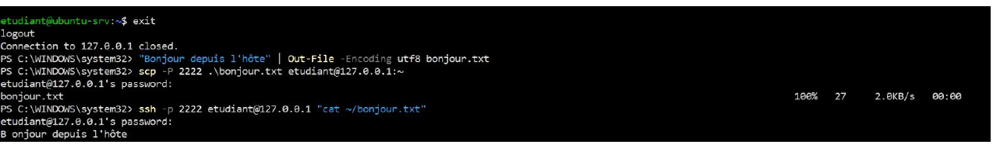

### Réponses aux questions

**1. Relevez l'adresse IP, le masque, la passerelle et le serveur DNS de la VM. À quoi correspond la passerelle 10.0.2.2 ?**

- Adresse IP : **10.0.2.15**
- Masque : **/24, soit 255.255.255.0**
- Passerelle : **10.0.2.2**
- Serveur DNS : **10.0.2.3** (serveur DNS du NAT VirtualBox)

La passerelle `10.0.2.2` est le **routeur virtuel du NAT de VirtualBox** : c'est par lui que passent tous les paquets de la VM vers Internet (il traduit les adresses, d'où le nom NAT).

**2. Pourquoi se connecte-t-on à `127.0.0.1:2222` et non directement à `10.0.2.15:22` ?**

`10.0.2.15` est une adresse **privée**, qui n'existe que dans le réseau virtuel NAT : elle est invisible depuis l'hôte. On se connecte donc au **port 2222 de l'hôte lui-même** (`127.0.0.1`), et VirtualBox **relaie** cette connexion vers le port 22 de la VM grâce à la règle de redirection.

**3. Que contient le message affiché à la première connexion SSH (empreinte) ? Quel risque permet-il d'éviter ?**

Le message affiche l'**empreinte (fingerprint) de la clé publique du serveur** (par exemple de type ED25519) et demande de confirmer la connexion (`yes`). Après acceptation, l'empreinte est enregistrée dans le fichier `known_hosts` de l'hôte.

Cela permet d'éviter l'**attaque de l'homme du milieu** (*man-in-the-middle*) : si un faux serveur se fait passer pour le vrai, son empreinte sera différente. Aux connexions suivantes, SSH compare l'empreinte et alerte (`REMOTE HOST IDENTIFICATION HAS CHANGED`) si elle a changé.

**4. Quels avantages offre l'authentification par clé par rapport au mot de passe ? Pourquoi les fournisseurs cloud l'imposent-ils par défaut ?**

- Une clé (par exemple ed25519) est **bien plus robuste** qu'un mot de passe : elle ne peut pas être devinée ni attaquée par force brute.
- Le secret (clé privée) **ne circule jamais** sur le réseau.
- On peut **désactiver complètement les mots de passe** sur le serveur, ce qui supprime la cible des attaques automatiques.
- Elle permet l'**automatisation** (scripts, déploiements) sans saisir de mot de passe.

Les serveurs cloud sont exposés sur Internet et attaqués en permanence : les fournisseurs (AWS, Azure) imposent donc les clés par défaut pour réduire ce risque.

---

## Partie 6 — Instantané, clone et arrêt

### Commandes lancées (PowerShell sur l'hôte, sauf indication)

1. Instantané de la VM propre :

```powershell
VBoxManage snapshot ubuntu-srv take apres-installation --description "Ubuntu installé, OpenSSH actif"
VBoxManage snapshot ubuntu-srv list
```

2. Modification dans la VM (par SSH), puis arrêt :

```bash
sudo apt install -y htop
touch ~/avant-restauration.txt
sudo poweroff
```

3. Restauration, redémarrage sans fenêtre et vérification :

```powershell
VBoxManage snapshot ubuntu-srv restore apres-installation
VBoxManage startvm ubuntu-srv --type headless
ssh -p 2222 etudiant@127.0.0.1 "which htop; ls ~"
```

4. Arrêt propre puis clonage (autre port hôte, 2223) :

```powershell
VBoxManage controlvm ubuntu-srv acpipowerbutton
VBoxManage clonevm ubuntu-srv --name ubuntu-clone --register
VBoxManage modifyvm ubuntu-clone --natpf1 delete ssh
VBoxManage modifyvm ubuntu-clone --natpf1 "ssh,tcp,127.0.0.1,2223,,22"
VBoxManage startvm ubuntu-clone --type headless
ssh -p 2223 etudiant@127.0.0.1 "sudo hostnamectl set-hostname ubuntu-clone; hostname"
VBoxManage list runningvms
```

5. Suppression du clone (`ubuntu-srv` est conservée pour les TP suivants) :

```powershell
VBoxManage controlvm ubuntu-clone acpipowerbutton
VBoxManage unregistervm ubuntu-clone --delete
```

### Résultats

- **Instantané** : `VBoxManage snapshot ubuntu-srv take apres-installation` affiche *Snapshot taken* avec son UUID, et `snapshot list` montre bien `apres-installation` (description « Ubuntu installé, OpenSSH actif »).

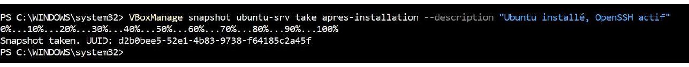
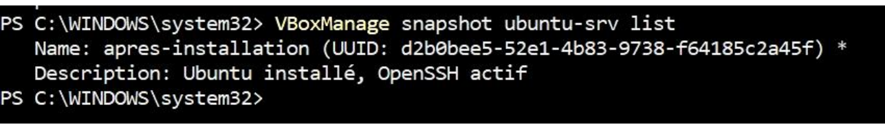

- **Test de restauration** : après la restauration de l'instantané `apres-installation`, `htop` et le fichier `avant-restauration.txt` ont disparu, la VM est revenue à l'état « propre ».
- **Incident rencontré** : au moment de se connecter en SSH, on obtient `ssh: connect to host 127.0.0.1 port 2222: Connection refused`, et `VBoxManage controlvm ubuntu-srv acpipowerbutton` répond *Machine 'ubuntu-srv' is not currently running*. La cause est simple : **la VM était éteinte** (c'est l'un des cas du tableau de dépannage de la fiche). Comme la VM était déjà arrêtée, l'arrêt propre n'était pas nécessaire et on a pu cloner directement.
- **Clone** : `clonevm` réussit (*Machine has been successfully cloned as "ubuntu-clone"*). On supprime la règle `ssh` héritée du clone puis on en crée une nouvelle sur le **port hôte 2223** (`ssh,tcp,127.0.0.1,2223,,22`), et le clone démarre en mode headless (*VM "ubuntu-clone" has been successfully started*).

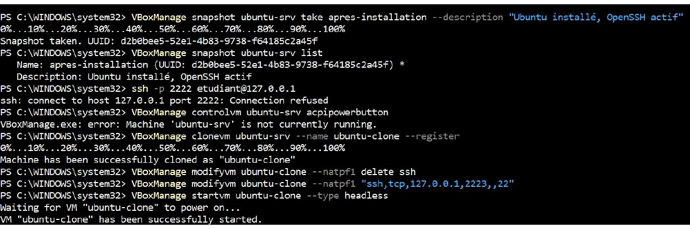

- Le clone est ensuite supprimé (`unregistervm --delete`) ; `ubuntu-srv` est conservée pour les TP suivants.

### Réponses aux questions

**1. Quelle différence entre un instantané et un clone ? Un instantané est-il une sauvegarde ? Justifiez.**

- Un **instantané (snapshot)** est l'**état de la VM à un instant donné**, enregistré **dans la même VM** : on peut y revenir plus tard (comme nous l'avons fait pour faire disparaître `htop`).
- Un **clone** est une **copie indépendante** de la VM : une nouvelle machine, avec son propre nom, son propre fichier disque et sa propre configuration.

**Un instantané n'est pas une sauvegarde** : il est stocké au même endroit que la VM et dépend du disque de base. Si le disque ou le fichier de la VM est perdu ou corrompu, l'instantané disparaît avec lui. Une vraie sauvegarde doit être stockée **séparément** (autre disque, autre site).

**2. Quels sont les équivalents cloud de l'instantané et du clone ?**

- Instantané → **snapshot de disque** (par exemple les snapshots EBS sur AWS).
- Clone → **image de machine** (AMI sur AWS, image Azure) à partir de laquelle on lance autant d'instances identiques que l'on veut.

**3. Quelle différence entre `acpipowerbutton` et `poweroff` dans `VBoxManage controlvm` ?**

- `acpipowerbutton` simule l'**appui sur le bouton d'alimentation** : le système invité reçoit le signal ACPI et **s'éteint proprement** (arrêt des services, écriture des données sur le disque).
- `poweroff` **coupe brutalement l'alimentation** de la VM, comme si on débranchait la prise : les données non écrites peuvent être perdues et le système de fichiers risque d'être corrompu.

C'est pourquoi nous avons utilisé `acpipowerbutton` avant de cloner.

**4. Pourquoi démarrer une VM en mode headless ? Quel lien avec une instance cloud ?**

Le mode **headless** démarre la VM **sans fenêtre graphique** : on économise des ressources et on administre la machine uniquement à distance, par SSH. C'est exactement le fonctionnement d'une **instance cloud**, qui n'a pas d'écran : on la crée et on s'y connecte à distance.

**5. Pourquoi faut-il changer le port hôte et le nom d'hôte du clone ?**

- **Port hôte** : le clone hérite de la règle de redirection `2222 → 22`. Si les deux VM tournent en même temps, le port 2222 de l'hôte est déjà utilisé par `ubuntu-srv` : conflit. On donne donc le port **2223** au clone, pour pouvoir joindre chaque VM séparément.
- **Nom d'hôte** : le clone est une copie exacte, il porte le même nom `ubuntu-srv`. Deux machines avec le même nom prêtent à confusion (on ne sait plus laquelle on administre) et peuvent poser problème sur un réseau. On le renomme donc `ubuntu-clone`.

---

## Synthèse : du TP au cloud IaaS

| Notre TP | Cloud IaaS |
|---|---|
| VirtualBox | Hyperviseur du fournisseur (Nitro, Hyper-V, KVM) |
| Image ISO | Image de machine (AMI, image Azure) |
| VM `ubuntu-srv` | Instance (EC2, VM Azure) |
| NAT + redirection 2222 | Sous-réseau privé + règle d'accès |
| Instantané | Snapshot de disque |
| SSH + clé | Accès par clé, imposé par défaut |

## Difficultés rencontrées

1. **Hyperviseur de Windows actif** : `systeminfo` signalait « Un hyperviseur a été détecté ». Nous l'avons désactivé avec `bcdedit /set hypervisorlaunchtype off` puis redémarré (voir partie 1).
2. **Mauvaise ISO** : nous avions téléchargé Ubuntu Desktop (6 Go) au lieu de Server. Nous l'avons remplacée par l'ISO `live-server` et vérifié son empreinte avant d'installer.
3. **Hôte limité** : environ 8 Go de RAM au total, donc la VM est limitée à 2 Go et 2 processeurs.

## Conclusion

Ce TP nous a montré ce que le cloud IaaS automatise : une instance est une VM qui tourne sur l'hyperviseur d'un autre, et nous avons joué les deux rôles. Nous avons installé un hyperviseur, créé une VM à partir d'une image vérifiée (SHA-256), isolé la machine derrière un NAT avec redirection de port, administré la VM par SSH, puis manipulé instantanés et clones : les mêmes gestes qu'avec l'API d'un fournisseur cloud.
